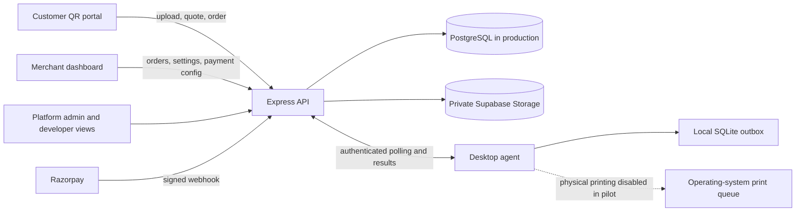
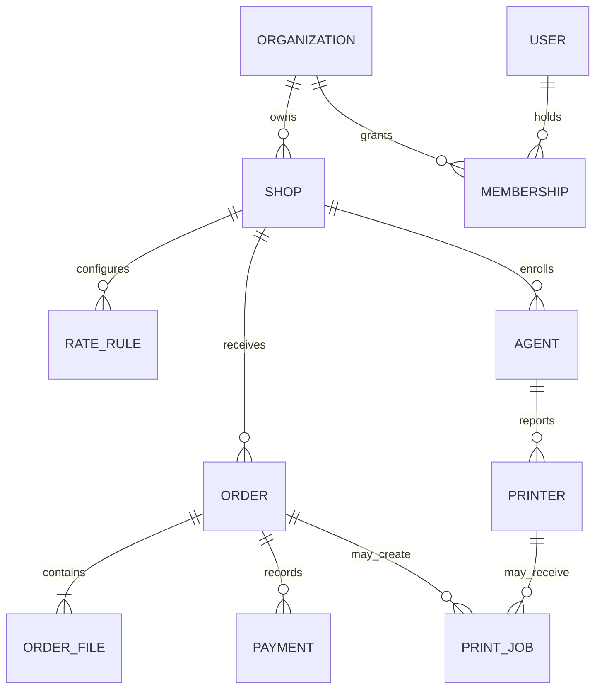

# Inklly Architecture

## Scope and runtime

Inklly is a multi-tenant print-shop workflow SaaS. The current implementation is a TypeScript npm-workspaces monorepo:

- `apps/web`: React and Vite customer, merchant, platform, developer, and marketing views.
- `apps/server`: Express API, authentication, tenant authorization, order/payment workflows, and platform endpoints.
- `apps/agent`: a separately run Node desktop agent with loopback diagnostics, SQLite persistence, and a cloud polling client.
- `packages/shared`: domain types, order/payment/print-job state machines, and integer-Paise pricing.
- `packages/db`: SQLite for local development/tests and PostgreSQL for deployed persistence, with repository boundaries and schema setup.

The web client talks to the versioned `/api/v1` API. The database is the source of truth for orders, payments, users, and shop settings. Local browser state is used for interaction state only; it is not authoritative for the customer order flow.

## Customer order and quote path

1. `GET /api/v1/portal/shop/:shopCode` returns public shop information and configured rate rules.
2. `POST /api/v1/portal/upload` validates and inspects file bytes, stores the document privately, and returns server-derived metadata plus a shop-scoped storage key.
3. `POST /api/v1/portal/quote` calculates a short-lived quote from server-side shop rates, page selection, colour mode, duplex mode, copies, copy discounts, and bulk discounts. Money is integer paise.
4. The customer view recalculates whenever files, print settings, or copy counts change. It displays server-returned line totals and discounts; it does not submit local price estimates.
5. `POST /api/v1/portal/orders` inspects stored files again and recalculates the total. A complete current quote must match shop, currency, amount, version, and expiry; otherwise the API returns a replacement quote and requires the customer to review it. The order records the server-derived amount and file settings.

Mixed colour requests price selected colour pages with the shop's colour rate and remaining selected pages with its B&W rate. Each mode can use its configured additional-copy discount. Paper-size options appear only when the shop has matching rate rules. Media GSM surcharges and finishing add-ons are not offered in checkout until they have a server-side configuration model.

Legacy API callers without a complete quote ID remain accepted for compatibility. The server still calculates and stores the authoritative amount, but only the current customer UI path guarantees explicit quote confirmation before submission. Remove this compatibility path before a public production release.

## Order, payment, and release states

Order, payment, and print-job states are separate domain values. Cash-on-collection orders enter `AWAITING_REVIEW` with payment `PENDING`. Razorpay orders enter `AWAITING_PAYMENT` with payment `NOT_STARTED`; verified capture moves payment to `VERIFIED` and the order to `AWAITING_REVIEW`.

The merchant UI has a dedicated `Payment Pending` queue. It permits inspection but shows no release or completion actions. The server also rejects print-release and collection transitions for an online order until payment is verified. Cash orders follow the merchant-approved collection policy.

The current print state machine includes `OUTPUT_UNCERTAIN`. Ticket handoff uses stable attempt identifiers and acknowledgement leases. An uncertain outcome is not automatically retried. Real physical printing is explicitly disabled by default in the pilot and is outside the current release claim.

## Tenant and security boundaries

- Authenticated sessions are signed and backed by revocable database session records.
- Merchant APIs derive the shop scope from the authenticated membership and enforce resource ownership server-side.
- Public customer routes resolve only an active shop by its public code; they do not treat a caller-supplied tenant header as authorization.
- Uploaded customer documents must use the private storage service. Production requires an HTTPS Supabase URL, service-role key, and an existing private bucket.
- Razorpay credentials are shop-scoped and encrypted at rest by the server service. Provider signatures and captured payment state are checked server-side.
- The platform admin surface is separately authenticated and privileged. Support access to document contents is not a general admin capability.

## Data relationships

The database schema includes additional subscription, ledger, refund, and audit structures. Recurring SaaS subscription billing and usage metering are not yet live, despite some schema and UI scaffolding.

## Desktop agent boundary

The agent makes outbound authenticated requests to the API, reports heartbeats, polls for shop-scoped tickets, stores local job results before network delivery, and retries result delivery after restart. Device credentials can be revoked. Local diagnostics bind to loopback. A signed installer is not configured on the current deployment. Printer discovery and a production Windows spooler workflow still require supported-hardware verification. The agent's physical print executor is disabled for the pilot.

## Deployment requirements

The deployed API uses PostgreSQL and private Supabase Storage. Render must define `DATABASE_URL`, `STORAGE_DRIVER=supabase`, `SUPABASE_URL` (HTTPS project URL), `SUPABASE_SERVICE_ROLE_KEY`, and `SUPABASE_STORAGE_BUCKET` (an existing private bucket). The latest provided Render log showed PostgreSQL connected but startup failed while validating Storage configuration. The Vercel frontend and Render API are separate deployments; a healthy HTTP response without a source revision does not prove that Render runs the current commit.

## Known limitations

- Physical printing is in product scope, but remains pilot-gated. If manually enabled, the current executor still does not reliably apply complete requested settings or prove physical output; keep `INKLLY_ENABLE_PHYSICAL_PRINTING=false` until those defects and hardware tests are complete.
- The current vault APIs can manage categories and read/delete document metadata, but there is no merchant vault document-upload API or connected UI workflow. Customer order attachments remain a separate temporary-storage flow.
- Recurring merchant subscriptions, per-printed-side billing, tax rules, and configured finishing/media surcharges are not implemented.
- WhatsApp intake/messaging is unavailable unless an official Meta integration is configured and verified.
- A signed agent installer and hardware-in-the-loop test evidence are unavailable.
- Background document processing and malware scanning are not separate durable workers yet.
- Production Supabase storage, payment-provider, monitoring, backup/restore, and privacy-retention behavior still need live verification.
