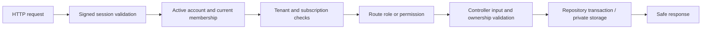

# Inklly — Smart Print-Shop Automation & Self-Service Document OS

[](https://gitdiagram.com/diagram/bhavish-s/inklly?utm_source=readme&utm_medium=badge)

> 🧠 **AI Agent & Multi-Machine Portable Notice:**  
> When unzipping this project on any new machine or using Antigravity CLI / AI coding assistants, **read [`BRAIN.md`](./BRAIN.md) first**. It contains complete persistent context, project scope, architecture map, implementation state, and build instructions.

Inklly is an early-stage multi-tenant SaaS product for existing print shops, photocopy centers, and document-service businesses. It is being built around countertop QR ordering, server-calculated prices in integer Paise, merchant operations, a separately installed desktop agent, and auditable financial records. See [`REMAINING_ISSUES.md`](./REMAINING_ISSUES.md) before using production data; the application is not yet production-ready.

---

## 🏗 Architecture & Workspace Structure

```text
D:\Inkly\Source Code\
├── BRAIN.md                    # Master memory & AI agent operational context
├── README.md                   # Public project documentation & quick start
├── IMPLEMENTATION_STATUS.md    # Phase-by-phase implementation ledger
├── BUILD_AND_TEST_RESULTS.md   # Current local build/test evidence and production limitations
├── REMAINING_ISSUES.md         # Production readiness & scope boundary documentation
│
├── apps/
│   ├── web/        # React + Vite Single Page Application (Marketing, Customer QR Portal, Merchant Dashboard, Platform Admin, Developer Hub)
│   ├── server/     # Multi-tenant Node.js Express REST API and agent command gateway
│   └── agent/      # Separately installed desktop agent; Windows physical printing is pilot-gated
│
├── packages/
│   ├── shared/     # Domain TypeScript models, state machines (Order, Payment, PrintJob), & deterministic pricing engine
│   └── db/         # Relational database and repository layer; local SQLite and production PostgreSQL adapters
```

---

## 🚀 Quick Start Guide

### 1. Prerequisites
- Node.js v20+ or v24+
- Windows, macOS, or Linux

### 2. Install Dependencies & Build All Workspaces
```bash
# In D:\Inkly\Source Code\
npm install
npm run build
```

### 3. Run Automated Tests
```bash
npm run test
```
*Runs the current tests across `@inklly/shared`, `@inklly/db`, `@inklly/agent`, `@inklly/server`, and `@inklly/web`. See [`BUILD_AND_TEST_RESULTS.md`](./BUILD_AND_TEST_RESULTS.md) for the last verified count and deployment limits.*

### 4. Running the Development Services

#### A. Backend API Server (Port 4000)
```bash
npm run dev:server
```
- Health Check: `http://localhost:4000/health`
- Shop QR API: `http://localhost:4000/api/v1/portal/shop/campus1`
- OpenAPI Specification: `http://localhost:4000/api/v1/developer/openapi.json`

#### B. Desktop Edge Print Agent Daemon (Port 8765)
```bash
npm run dev:agent
```
- Status & Diagnostics: `http://127.0.0.1:8765/status`
- The local HTTP interface is read-only; it exposes `/status` and `/health`, not a browser-accessible queue.

#### C. Frontend Web Application & Inklly Website (Port 3000)
```bash
npm run dev:web
```
- Inklly Website & Portals: `http://localhost:3000/`
  - Print Shop Automation: `http://localhost:3000/print-shop-automation-software`
  - WhatsApp Printing: `http://localhost:3000/whatsapp-printing-software`
  - QR Code System: `http://localhost:3000/qr-code-printing-system`
  - How It Works: `http://localhost:3000/how-it-works`
  - Transparent Pricing: `http://localhost:3000/pricing`
  - Contact: `http://localhost:3000/contact`
  - Merchant Login: `http://localhost:3000/login`
  - Merchant Sign Up: `http://localhost:3000/register`
  - Legal Policies: `http://localhost:3000/legal/privacy-policy`
- Customer QR Portal (local seeded fixture): `http://localhost:3000/p/campus1` (production requires a provisioned, online shop)
- Merchant Workspace (Order Queue, Rates, Printers, Staff): `http://localhost:3000/merchant`
- Platform Owner Console (GMV, Ledger, Organizations): `http://localhost:3000/platform` (or `/admin`)
- Developer Portal (OpenAPI Spec, API Key Generator, Webhooks): `http://localhost:3000/developer`

---

## 🪟 Windows One-Click Launchers
For Windows users where PowerShell script execution is restricted (`PSSecurityException`), run the batch files directly:
- `start-all.bat`: Launches Server, Desktop Agent, and Web App concurrently in separate windows.
- `run-tests.bat`: Runs the current npm workspace test suite.
- `start-server.bat`: Runs port 4000 backend API server.
- `start-agent.bat`: Runs port 8765 edge spooler daemon.
- `start-web.bat`: Runs port 3000 web application.

---

## Product lifecycle diagrams

### Customer order lifecycle

```mermaid
flowchart LR
  A[Shop QR] --> B[Upload and inspect document]
  B --> C[Server quote in integer paise]
  C --> D[Customer confirms order]
  D --> E{Payment method}
  E -->|Cash| F[Await merchant review]
  E -->|Razorpay| G[Provider payment verification]
  G --> F
  F --> H[Merchant releases order]
  H --> I[Agent polls authorized queue]
  I --> J[Local validation and spooler submission]
  J --> K{Outcome known?}
  K -->|Yes| L[Ready for pickup]
  K -->|No| M[OUTPUT_UNCERTAIN; operator reconciliation]
  L --> N[Merchant records collection]
```



### Merchant API request pipeline



### Desktop agent dispatch

```mermaid
sequenceDiagram
  participant M as Merchant API
  participant A as Paired desktop agent
  participant Q as Local durable queue
  participant S as OS spooler
  M->>A: Authenticated poll for assigned shop/printer jobs
  A->>Q: Persist ticket before processing
  A->>M: Acknowledge stable dispatch ID
  A->>Q: Validate file and print settings
  A->>S: Submit supported job
  S-->>A: Spooler result (not physical-output proof)
  A->>Q: Persist result for retryable reporting
  A->>M: Report outcome
  Note over A,M: Ambiguous output becomes OUTPUT_UNCERTAIN; never auto-retry
```

## Verified safety behavior and current limits

- **Print uncertainty:** ambiguous dispatch outcomes become `OUTPUT_UNCERTAIN`; automatic retries are withheld pending operator reconciliation. Physical printing remains pilot-gated and has not been verified on supported hardware.
- **Pricing:** the shared pricing engine calculates print quotes in integer Paise. Local tests cover core pricing rules; tax and advanced billing policies remain incomplete.
- **Tenant authorization:** merchant routes require signed persisted sessions, active accounts, current shop membership, tenant scoping, and route-specific permissions. Continue adding ownership tests for each resource type.
- **Payment:** Shop Razorpay payment and platform-owned monthly subscription checkout paths are implemented in source, but live credentials and sandbox/webhook round trips are unverified. Operator-confirmed print-side usage is recorded; usage statements remain manual and do not collect payment.
- **Merchant billing:** the workspace shows confirmed print-side usage and manual pilot statements. Conversion-credit purchases are unavailable until a provider-backed purchase and conversion workflow exists; the UI does not show simulated balances or success.
- **Settlements and referrals:** customer payments settle directly to each shop's connected Razorpay account or are collected at the counter. Inklly does not offer merchant payouts or referral rewards during the pilot; those screens contain no sample balances or local-only success actions.
- **Financial records:** database migrations install append-only ledger protections and provider transaction uniqueness. SQLite tests cover these protections; live Supabase migration, database-owner bypass protection, and full reconciliation remain unverified.
- **Developer integrations:** shop-bound API keys are available only when `ENABLE_EXTERNAL_API_ACCESS=true` and enforce environment, expiry, revocation, membership, and scopes. Webhook order-created, order-status, and payment-success events now use a transactional outbox, timestamped HMAC-SHA256 delivery, pinned public HTTPS destinations, bounded retries, and persisted attempt history. External API access remains off by default; hosted delivery, secret rotation/revocation, and further event types remain unverified or incomplete.
- **Platform administration:** tenant, ledger, audit, enquiry, retention, agent data, and monthly checkout/reconciliation use backend records. Installer distribution, persistent incident management, audited runtime configuration, recurring charges, and quota enforcement remain incomplete. The console labels unavailable workflows instead of presenting sample records as live.
- **WhatsApp and agent installer:** WhatsApp setup/pairing requests fail closed until provider onboarding is implemented. A signed production agent installer is unavailable, and physical printing is disabled by default.

### Developer webhook delivery

Webhook management and dispatch require `ENABLE_EXTERNAL_API_ACCESS=true`. The currently emitted event types are `order.created`, `order.status_changed`, and `payment.succeeded`. Event records and per-destination deliveries are created in the same database transaction as their source order/payment changes.

Each POST body is an event envelope containing `eventId`, `eventType`, an ISO `timestamp`, and `data`. The worker sends `X-Inklly-Event`, `X-Inklly-Delivery` (the stable event ID), and `X-Inklly-Signature: t=<unix-seconds>,v1=<hex>`. Verify the signature against the exact raw request body using HMAC-SHA256 with `${timestamp}.${rawBody}` and the one-time `whsec_...` secret. Use `eventId` for receiver-side deduplication. A 2xx response marks delivery complete; redirects are not followed. Attempts have an 8-second timeout and retry with exponential backoff for up to eight attempts. DNS is re-resolved for each attempt, every answer must be public, and the selected IP is pinned for TLS while the destination hostname remains the SNI and certificate name.

Delivery history is available at `GET /api/v1/developer/webhooks/{id}/deliveries`. Secret rotation is available at `POST /api/v1/developer/webhooks/{id}/rotate-secret`; it returns a new secret once and refuses while an attempt is in progress. Revoke a destination with `DELETE /api/v1/developer/webhooks/{id}`; pending deliveries are cancelled, and history remains available to the organization. Live hosted delivery remains unverified.

## Current verification

See [`BUILD_AND_TEST_RESULTS.md`](./BUILD_AND_TEST_RESULTS.md) for exact local build/test output and [`REMAINING_ISSUES.md`](./REMAINING_ISSUES.md) for deployment blockers. The current local worktree builds successfully and passes 275 tests; the printer-capability dispatch changes are included in pushed commit `a4cd93b` on GitHub `main`. Render health currently responds HTTP 200 but omits a revision; its OpenAPI response has no merchant storage-document GET operation, so deployment of the latest backend commit is unconfirmed. An earlier live probe also found anonymous developer-key access returning 200 instead of the current source's 401. These checks do not establish live webhook, payment, PostgreSQL, object-storage, or hardware behavior.
