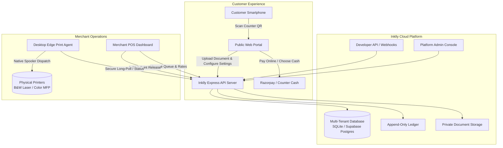

# Inklly — Cloud-Connected Print Shop Automation & Self-Service Document OS

<div align="center">
  
  <h3>Turn Any Countertop Into a High-Speed, Automated Print Station</h3>
  <p>QR Self-Service Intake • 4-Digit Token Queue • Deterministic Paise Pricing • Dual B&W/Color Routing • Append-Only Ledger</p>

  [](https://github.com/Bhavish-S/Inklly)
  [](https://inklly.vercel.app)
  [](https://inklly.onrender.com)
  [](#license)
</div>

---

## 📌 Overview

**Inklly** is an end-to-end, multi-tenant SaaS operating system purpose-built for commercial print shops, university photocopy kiosks, stationery centres, and corporate reprographics hubs. 

By replacing chaotic WhatsApp file forwarding, USB pendrive malware risks, and manual queue bottlenecks with an instant, branded **Countertop QR Portal**, Inklly streamlines the entire print lifecycle: from customer upload and server-side pricing to one-click desktop hardware dispatch and real-time ledger accounting.

---

## 🌟 Key Features

### 1. 📱 Customer Self-Service Countertop QR Portal
* **Zero App Installation:** Customers scan the counter QR code (`<your-domain>/p/<shopCode>`) using any smartphone browser.
* **Document Upload:** PDF, JPG and PNG (export Word/Excel to PDF first), page count read on the server from the file itself.
* **Document Editor:** drag-to-crop (mouse or touch), content-detecting auto-crop, 90° rotation, and scan enhancement (Document B&W, Enhanced, Grayscale, brightness/contrast). PDF crop/rotation keep text as vectors; enhancement re-renders pages at 200 dpi.
* **Precise Print Customization:** Configure copies, print modes (**Black & White** vs **Full Color**), page orientations, single-sided or double-sided (duplex), and custom page ranges (e.g., `1-5, 8, 12-18`).
* **Deterministic Server-Side Pricing:** Calculates real-time quotes down to integer **Paise** (`₹0.01` precision) with bulk discounts and tiered rates, preventing floating-point rounding errors.
* **4-Digit Token System:** Every order receives a memorable 4-digit pickup token (e.g., `#4821`) for queue coordination and counter pickup.
* **Flexible Payment Methods:** Instant online payment via UPI/Razorpay or Cash-at-Counter collection.

### 2. 🏪 Merchant Counter POS Workspace (`/merchant`)
* **Live queue:** new QR orders arrive with a chime; filters for To print, Printing and Pickup.
* **Document Peek Modal:** Full-screen inspector for operators to review customer files, page settings, and color flags before release.
* **Counter screen (staff stay in control):** nothing prints automatically. Staff type the customer's token, name or phone, see every file and setting, choose a printer for each file (Inklly suggests colour files → colour printer, the rest → B&W printer), press Print, confirm the pages, then record cash or UPI (with an exact-amount UPI QR) and hand over. Keyboard: P print · K pages OK · C cash · U UPI · H hand over.
* **Payment at handover:** Collect cash payments at the counter with one click, automatically posting balancing ledger entries to ensure financial accuracy.
* **Custom Rate Engine:** Configure base per-page prices, duplex discounts, additional copy discount tiers, and custom paper surcharges (A4, A3, Legal, Glossy, Bond).
* **Multi-Printer Hardware Management:** Register USB, LAN, or network printers with supported tray specifications and capability profiles.
* **Role-Based Staff Access:** Grant granular permissions using pre-built roles (`Shop Manager`, `Print Operator`, `Front Desk Staff`).

### 3. 🖨️ Desktop Edge Print Agent Daemon (`apps/agent`)
* **Works with any printer the computer can print to:** Windows print queues (via bundled SumatraPDF) and CUPS queues on macOS/Linux (`lp`), so USB, network, shared and AirPrint/IPP Everywhere printers of any brand work through their normal OS driver.
* **Automatic capability detection:** colour, duplex and A4/A3 support are read from each driver (Win32_Printer capabilities, CUPS printer-type/PPD options) and make a new printer ready without manual setup; a merchant-saved profile always wins. Printers are rediscovered every minute.
* **Hardware Safety Invariants:** Ambiguous outcomes or paper jams trigger `OUTPUT_UNCERTAIN` status rather than dangerous duplicate prints.
* **Authenticated Polling:** Uses secure, token-authenticated long-polling with lease-based idempotency to guarantee zero double-dispatches.

### 4. 💬 WhatsApp Automation Hub (planned — not built yet)
* **Direct Intake via WhatsApp:** Customers can send documents directly to the shop's WhatsApp business number to receive instant quote links.
* **Automated Status Notifications:** Automatic pickup alerts sent to customers when their documents finish printing.
* **Daily Performance Digests:** Daily morning summary alerts showing shop GMV, total pages printed, and paper usage metrics.

### 5. 🛡️ Platform Admin Console (`/platform`)
* **Multi-Tenant Shop Fleet Management:** Monitor active Indian print shops, regional distribution, and hardware telemetry.
* **Financial Ledger & GMV Auditing:** Double-entry append-only ledger tracking subscription revenues, customer payments, and platform health.
* **Tiered Subscription Plans:** Configured for Indian print shop economics:
  * **Starter:** ₹99/month (300 orders/mo, 1 printer)
  * **Growth:** ₹199/month (1,500 orders/mo, 2 printers)
  * **Pro:** ₹499/month (6,000 orders/mo, 5 printers)
  * **Scale:** ₹899/month (50,000 orders/mo, 10 printers)
  * **Lifetime License:** ₹1,499 one-time payment with permanent access and **0% commission on customer prints**.

### 6. 💻 Developer API & Webhook Portal (`/developer`)
* **OpenAPI 3.0 Specification:** Complete interactive documentation available at `/api/v1/developer/openapi.json`.
* **Scoped API Keys:** Issue environment-specific keys (`ink_live_...`, `ink_test_...`) with fine-grained scopes (`orders:read`, `orders:write`).
* **Transactional Webhooks:** Guaranteed at-least-once delivery with HMAC-SHA256 timestamped signatures (`order.created`, `order.status_changed`, `payment.succeeded`).

---

## 🏛️ System Architecture



---

## 📂 Monorepo Structure

```text
Inkly/Source Code/
├── apps/
│   ├── web/            # React 18, Vite, Tailwind CSS, PDF.js Single Page App
│   │   ├── src/pages/      # Landing, Pricing, Register, Login, Merchant, Platform, Developer
│   │   ├── src/components/ # Navbar, Footer, Queue Tables, Peek Modal, Icons
│   │   └── src/api/        # Type-safe API client and session management
│   │
│   ├── server/         # Node.js 24 + Express REST API Gateway
│   │   ├── src/controllers/# Auth, Portal, Orders, Printers, Rates, Subscriptions
│   │   ├── src/middleware/ # Session tokens, tenant isolation, rate limiting
│   │   └── src/services/   # Razorpay, Webhook dispatcher, Ledger engine
│   │
│   └── agent/          # Standalone Desktop Spooler Daemon
│       ├── src/daemon.ts   # Edge queue poll loop & status HTTP server
│       └── src/spooler.ts  # Windows/Unix native printer driver executor
│
├── packages/
│   ├── shared/         # Shared TypeScript domain contracts
│   │   ├── models/         # Order, Shop, User, Printer, Payment schemas
│   │   ├── pricing/        # Deterministic integer-Paise price calculation engine
│   │   └── state-machines/ # Order, Payment, and PrintJob lifecycle invariants
│   │
│   └── db/             # Relational Database Abstraction Layer
│       ├── repositories/   # Shop, User, Order, Printer, Ledger repositories
│       ├── migrations/     # Idempotent incremental database migrations
│       └── schema.sql      # Core schema definitions (SQLite & PostgreSQL compatible)
│
└── package.json        # Monorepo workspaces manifest
```

---

## ⚡ Quick Start & Local Development

### Prerequisites
* **Node.js:** v24.x or higher
* **npm:** v10.x or higher
* **Git**

### 1. Clone & Install Dependencies
```bash
git clone https://github.com/Bhavish-S/Inklly.git
cd Inklly/"Source Code"

# Install all workspace dependencies
npm install
```

### 2. Build All Workspaces
```bash
npm run build
```

### 3. Run Automated Tests
Inklly maintains an exhaustive test suite covering multi-tenancy isolation, integer-Paise pricing precision, order state machines, and API endpoints:
```bash
npm test
```
*Current test suite: **320 tests** (database 25, shared 16, agent 26, server 240, web 13) passing with 0 failures.*

### 4. Start Development Services

You can launch each service individually or run them concurrently:

#### Backend API Server (Port `4000`)
```bash
npm run dev:server
```
* Health Endpoint: `http://localhost:4000/health`
* OpenAPI Specs: `http://localhost:4000/api/v1/developer/openapi.json`

#### Frontend Web Application (Port `3000`)
```bash
npm run dev:web
```
* Main Application: `http://localhost:3000/`
* Merchant Login: `http://localhost:3000/login`
* Merchant Register: `http://localhost:3000/register`
* Demo Shop Portal: `http://localhost:3000/p/campus1`

#### Desktop Edge Agent (Port `8765`)
```bash
npm run dev:agent
```
* Local Status Endpoint: `http://127.0.0.1:8765/status`

---

## 🔑 Local Demo Credentials (development only)

These accounts are created only when `NODE_ENV` is not `production`. Production never creates demo accounts and never uses a built-in admin password: set `PLATFORM_OWNER_EMAIL` and a unique `PLATFORM_OWNER_PASSWORD` (16+ characters) for the first boot.

| Portal | Role | Email | Password |
| :--- | :--- | :--- | :--- |
| **Merchant POS** | Merchant Owner | `owner@campusprint.in` | `DemoOwnerPassword123!` |
| **Merchant Staff** | Desk Operator | `operator@campusprint.in` | `DemoOperatorPassword123!` |
| **Platform Admin** | Platform Owner | `admin@inklly.com` | `DemoPlatformPassword123!` |
| **Developer Hub** | API Developer | `dev@inklly.com` | `DemoDeveloperPassword123!` |

*(In development builds the `/login` screen has 1-click fill buttons for these; production builds do not show them.)*

--- | :--- | :--- | :--- |
| **Merchant POS** | Merchant Owner | `owner@campusprint.in` | `DemoOwnerPassword123!` |
| **Merchant Staff** | Desk Operator | `operator@campusprint.in` | `hash_staff_123` |
| **Platform Admin** | Platform Owner | `admin@inklly.com` | `InkllyAdmin2026!PlatformOwner` |
| **Developer Hub** | API Developer | `dev@inklly.com` | `DemoDeveloperPassword123!` |

*(The `/login` screen includes 1-click quick-fill buttons for each of these personas).*

---

## 🌐 Production Deployments

Inklly is deployed and continuously delivered across cloud environments:

* **Production Web App:** [https://inklly.vercel.app](https://inklly.vercel.app)
* **Production API Service:** [https://inklly.onrender.com](https://inklly.onrender.com)
* **Database Infrastructure:** Supabase PostgreSQL with pooled connections and local SQLite fallback.

---

## 🔒 Security & Data Integrity

* **Zero Rounding Inaccuracies:** Quotes, discounts, and order amounts are strictly computed and stored as positive integer **Paise** (`₹1.00 = 100 paise`).
* **Multi-Tenant Isolation:** All database queries require tenant scoping (`organization_id` & `shop_id`). Cross-tenant query execution fails closed.
* **Append-Only Financial Ledger:** Subscription fees, print payments, and cash reconciliations are recorded into immutable ledger journals.
* **Private Storage Retentions:** Customer print files are encrypted in transit and purged automatically following completed order lifecycle retention deadlines.

---

## 📄 License

Copyright © 2026 Inklly. All rights reserved.  
Distributed under the MIT License. See `LICENSE` for details.
